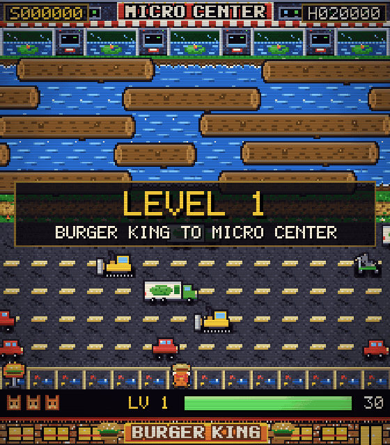
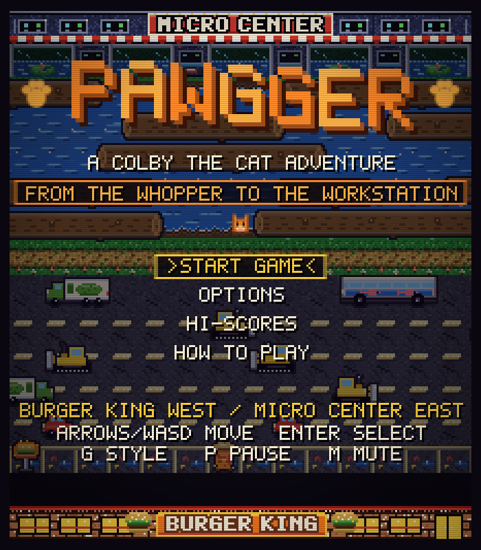
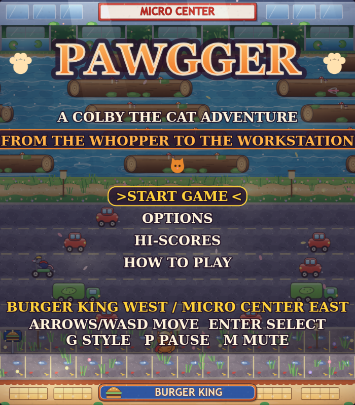
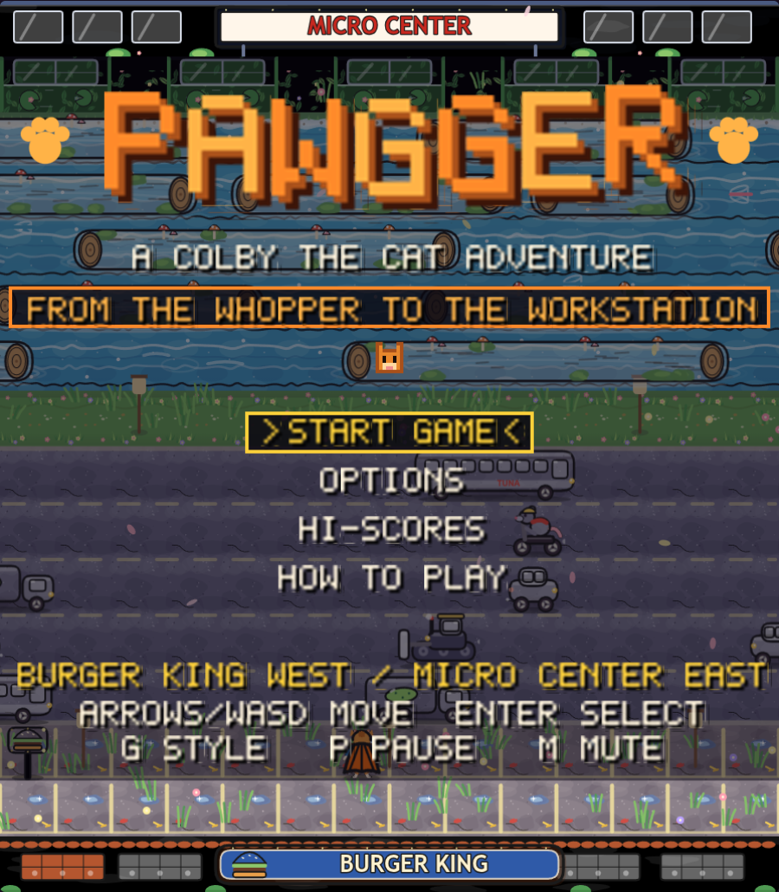
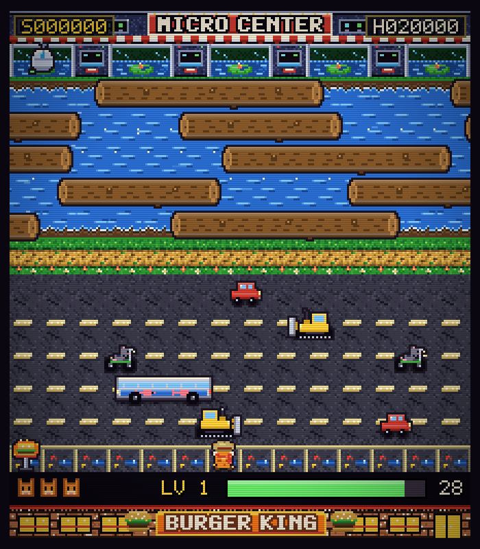
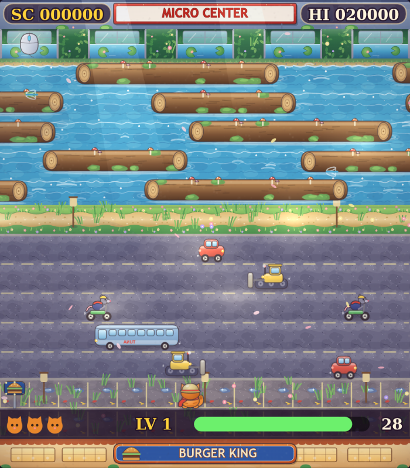
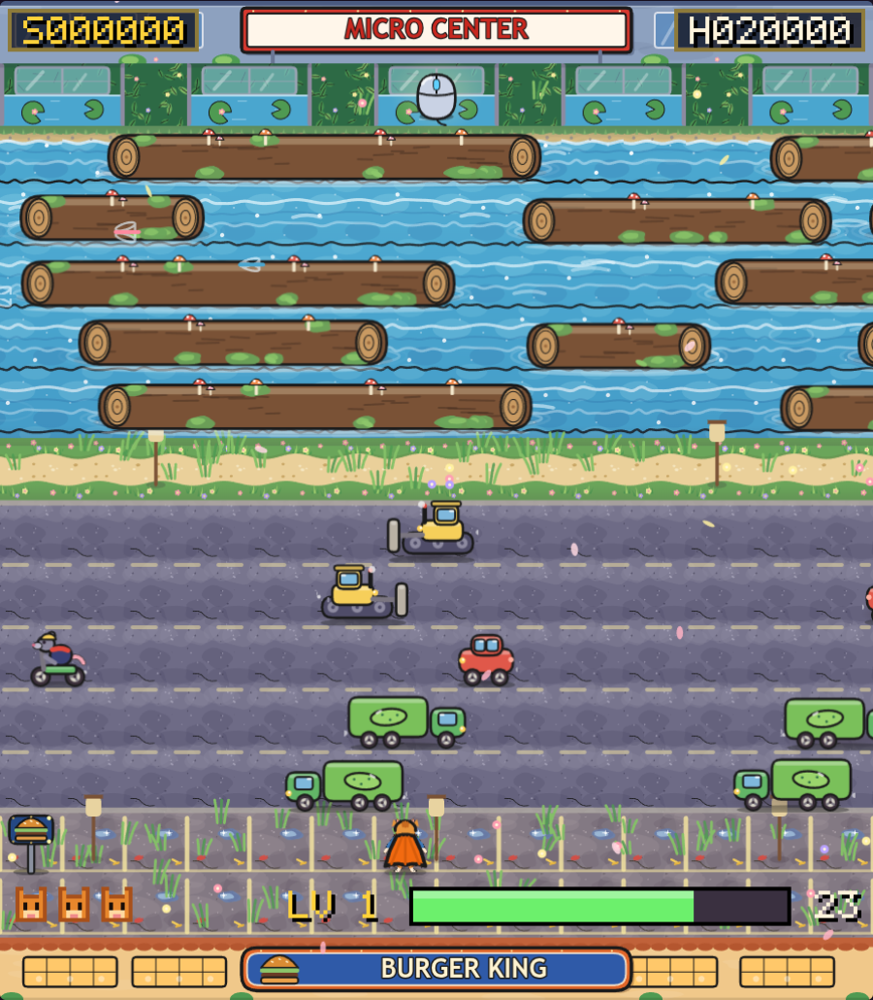
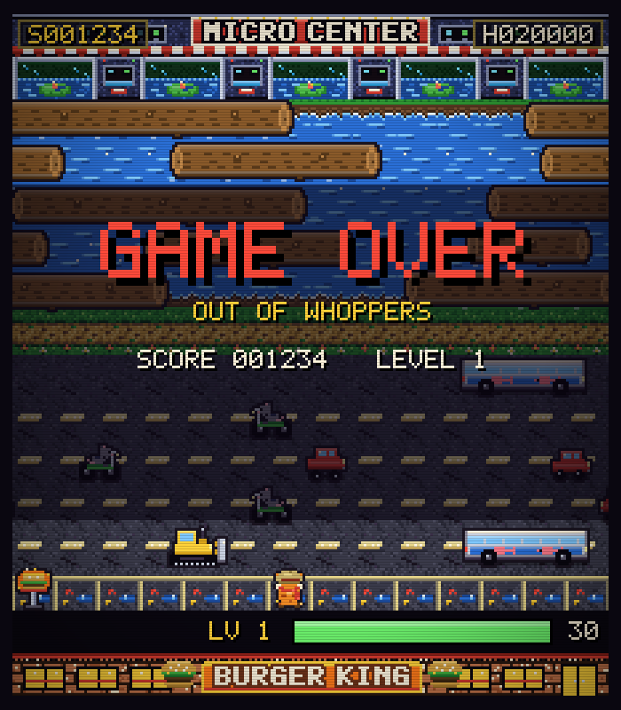
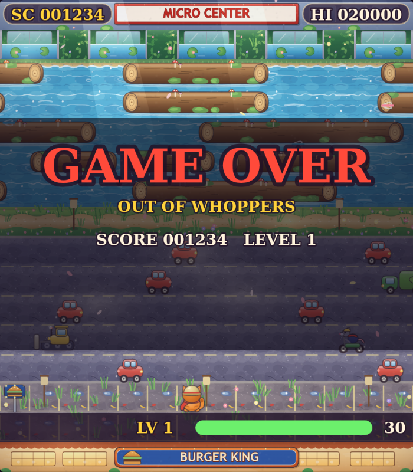
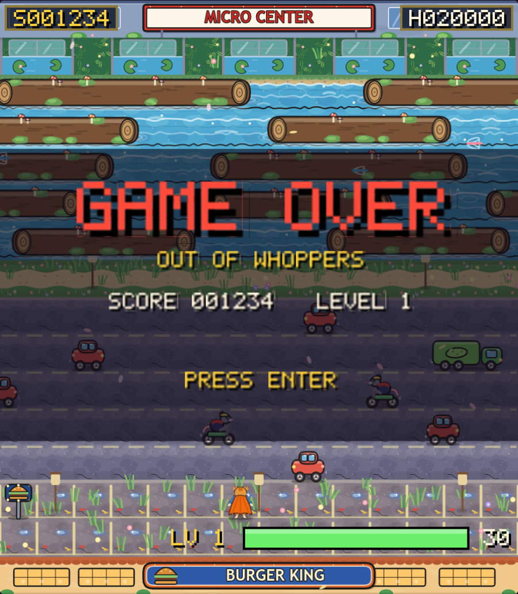

<p align="center"></p>

<h1 align="center">Pawgger</h1>
<p align="center"><b>FROM THE WHOPPER TO THE WORKSTATION</b></p>

<p align="center">
  <a href="https://bsommers.github.io/pawgger/play/"></a>
  <a href="https://github.com/bsommers/pawgger/actions/workflows/pages.yml"></a>
  <a href="LICENSE"></a>
  
  
</p>

A Frogger parody. Colby, an orange tabby, has just finished a triple whopper at the Burger King and must hop across Perring Parkway to the Micro Center, where the computer nerds are waiting. Standing in his way is Perring Parkway Pete, a rat with a fedora and a limo. Keyboard only, plays offline once loaded.

## Three styles, one game

Press **G** to cycle between styles, or open the page with `?style=retro`, `?style=ghibli` or `?style=toon`. Layout, sim and names are identical in all three; only the look changes.

<table>
  <tr>
    <th>retro (8-bit)</th>
    <th>ghibli (painterly)</th>
    <th>toon (character library)</th>
  </tr>
  <tr>
    <td></td>
    <td></td>
    <td></td>
  </tr>
  <tr>
    <td></td>
    <td></td>
    <td></td>
  </tr>
  <tr>
    <td></td>
    <td></td>
    <td></td>
  </tr>
</table>

## The story

Perring Parkway runs north to south. The **Burger King** sits on the west side, and the **Micro Center** on the other. Colby starts in the Burger King lot (row 13) with a triple whopper in his belly and crosses five lanes of river logs and turtles, a median where Pete patrols, and a road full of traffic. The far side is the Micro Center storefront with its five home bays. Fill a bay and Colby is handed a shopping bag; a mouse (200 points) or a graphics card (150 points) waits in the bay, and the nerds cheer when the level clears. Pete's taunts: "THE NERDS CAN WAIT, FUR-BALL!" and "NO WHOPPER, NO ENTRY!"

Level 1 is the Burger King to Micro Center run. Each level after cycles through day, dusk and night.

**Parody notice:** Burger King and Micro Center are used as affectionate parody references. This project is not affiliated with, sponsored by or endorsed by either company. All signage, buildings, art, music and code are original.

## Features

- Three switchable styles: retro 8-bit, ghibli painterly, and toon (Colby and Pete built from the character library)
- Day, dusk and night levels with matching music and sky grading
- Bonuses in the bays and pickups in the lanes: whopper, fries, tuna, sardine, gold and collar
- Generated levels checked by a validator, so every level is fair
- Autopilot bot: clears levels 1-10 on seeds 1-10
- 244 tests, zero dependencies, and a single-file build that plays offline

## Controls

| Key | Action |
|---|---|
| Arrow keys / WASD | Hop one cell |
| Space / Z / X | Jump |
| Enter | Confirm |
| Escape | Back |
| P | Pause |
| G | Cycle style: retro, ghibli, toon |

More detail in [docs/HOW-TO-PLAY.md](docs/HOW-TO-PLAY.md).

## Run, build, test

```
npm start                         # serve on http://127.0.0.1:4781/
npm test                          # 244 node:test tests, no dependencies
node tools/build-web.mjs          # dist/pawgger.html, one self-contained file
node tools/shots.mjs              # refresh the screenshots in out/shots/
node tools/shots.mjs --hero --only none && sh tools/make-gif.sh   # hero GIF (needs ffmpeg)
```

The site is published by [`.github/workflows/pages.yml`](.github/workflows/pages.yml): the showcase at `/` and the playable build at `/play/`.

## How it is built

Pure ES modules, Canvas 2D, procedural pixel and painted art, and WebAudio. No build step is needed to run it. See [ARCHITECTURE.md](ARCHITECTURE.md) for the module contract and [docs/HOW-IT-WAS-MADE.md](docs/HOW-IT-WAS-MADE.md) for the module-by-module account.

## Built by an agent swarm

Pawgger was built by a swarm of parallel AI agents, each owning one disjoint module and writing a report. The plan assigned 17 modules to Sonnet and 3 to Haiku. Every report, with its verification evidence, deviations and mistakes, lives in [docs/swarm/reports](docs/swarm/reports). Lessons are in [docs/LEARNINGS.md](docs/LEARNINGS.md).

What was verified: the test suite (244 passing), headless screenshots in all three styles, and bot runs through levels 1-10. What was **not** verified: the audio was never listened to by a human. It is tested and generated, not judged by ear.

## Credits and notes

Design, code, pixel art, painted art and music by the Pawgger swarm. Colby and Pete in the toon style come from the character library. Pawgger is an affectionate parody, is not affiliated with or endorsed by Burger King, Micro Center or any other trademark it riffs on, and uses no copied logos.

## Licence

Code and original art are released under the [Apache License 2.0](LICENSE). The Colby and Pete turnaround sheets used by the toon style come from the character library and are CC0-1.0 (see `src/art/toon/library/manifest.json`). Burger King and Micro Center are named only as an affectionate parody; no trademarks or logos are used or licensed here.
